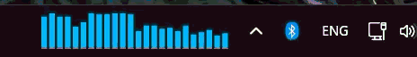
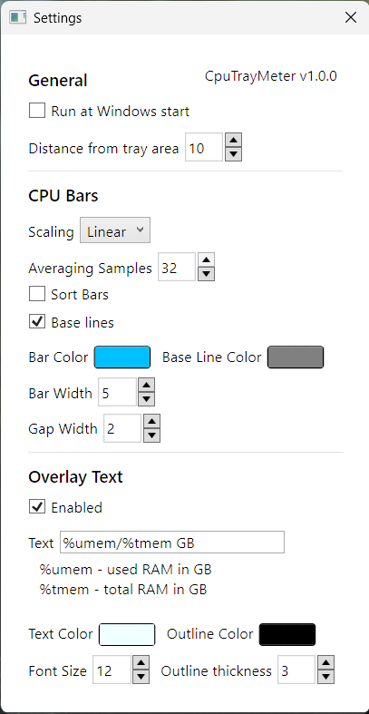

# CPUTrayMeter
Simple graphical display of CPU cores utilization in system tray for Windows 10/11

## Usage
Options menu is accessible by clicking on the app window in system tray.

## Why and how
Back in Windows Forms days, application could render onto system taskbar using Deskband API, but that was deprecated in Windows 7, and finally removed in 11. The new API introduced in 11 (Widgets) is fairly restricted in terms of both functionality and app distribution. Fortunately, since taskbar (and system tray area) are just regular windows that can be accessed via their handle, we can just create regular window (in this case WPF), and parent it to taskbar using winapi from C# via P/Invoke.

## License
Licensed under MIT license (see [LICENSE](LICENSE) for details), with the exception of [src/OutlinedTextBlock.cs](src/OutlinedTextBlock.cs) which is taken from StackOverflow post and licensed under CC-BY-SA 3.0 (see the file for detais)

